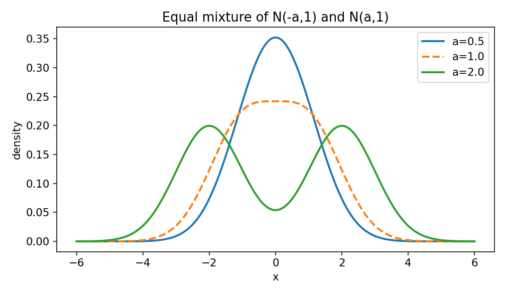
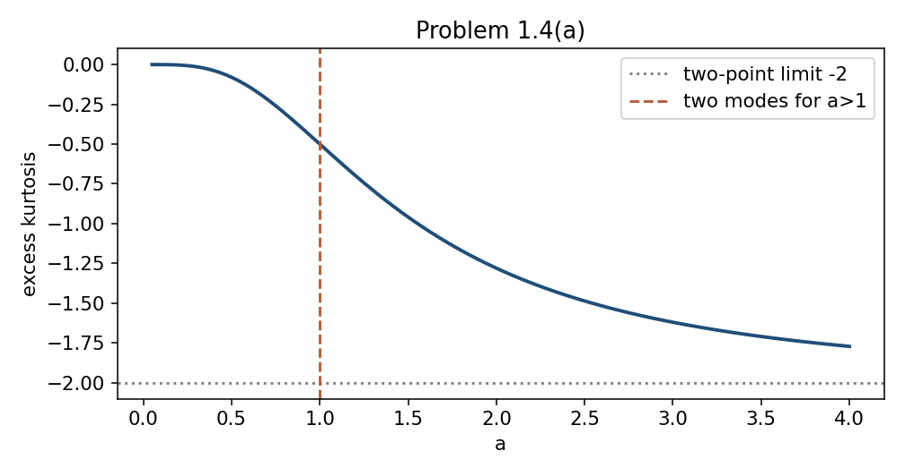
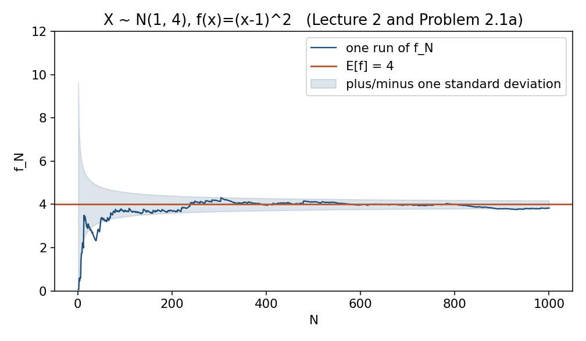
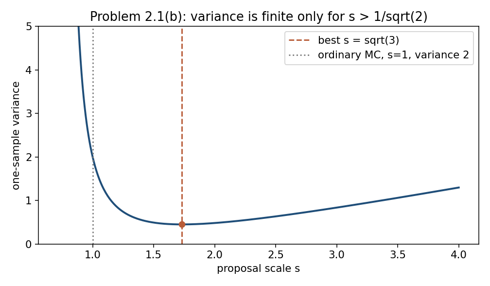
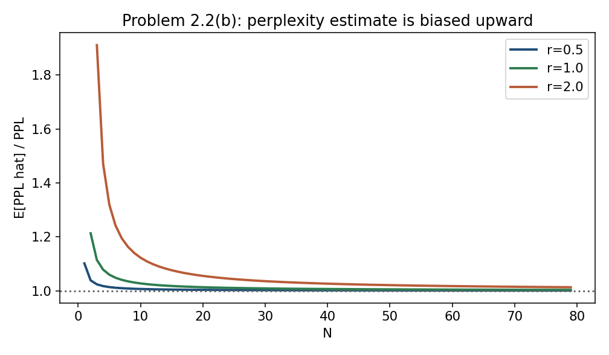
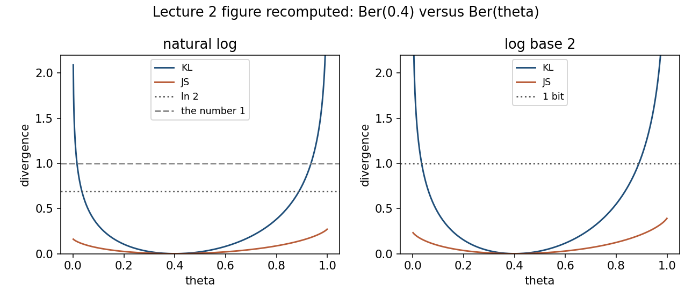
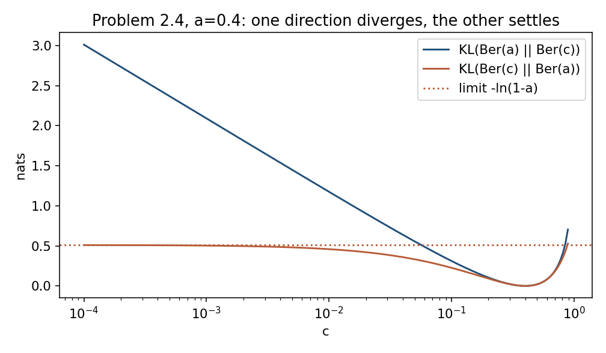
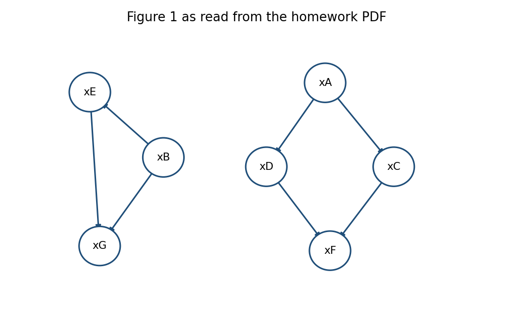
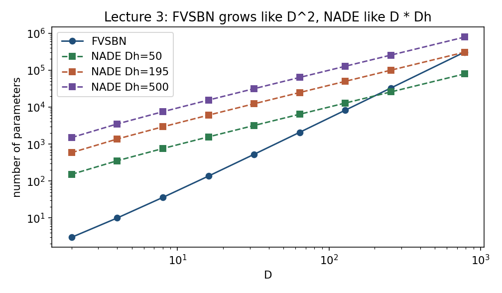
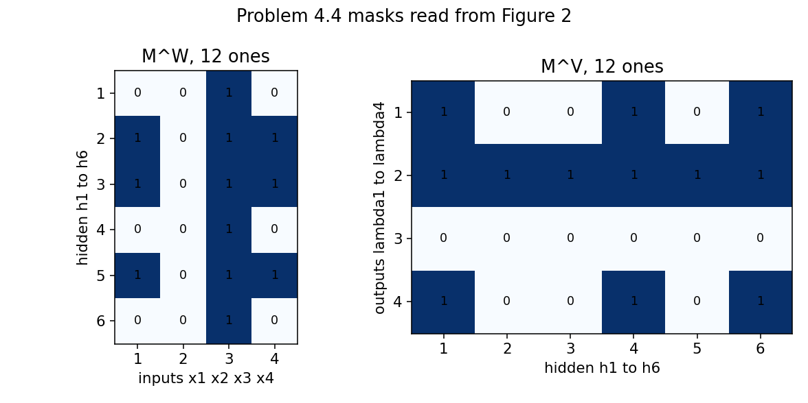

# Homework 1, validated against the course slides

This file does not change `HW1_solutions.md`. It rechecks that write-up against

- `DGM_L00_Logistics.pdf` (course books and the rule that homework is theory-first),
- `DGM_L02_Foundation.pdf` (Gaussian, expectation, Monte Carlo, KL, Jensen–Shannon),
- `DGM_Transition_L03_Autoregressive.pdf` (logistic regression, FVSBN, NADE, real NADE, MADE),

and against direct calculations and plots in `HW1_figures/`.

Logs below are natural unless a part says otherwise. The homework’s perplexity uses \(\ln\). Lecture 2 writes \(\log\) and states \(0\le\mathrm{JS}\le 1\) with no base; that conflict is the point of Problem 2.3(a), not a mistake in the solution.

---

## Audit of the previous solutions

No final answer in `HW1_solutions.md` had to be withdrawn. The formulas that the lectures state explicitly agree with that file:

| Lecture claim | Where | Previous answer |
|---|---|---|
| \(\mathbb E[(X-1)^2]=4\) for \(X\sim\mathcal N(1,4)\) | L02, Monte Carlo slide | Problem 2.1(a), same example |
| KL is not symmetric, is nonnegative, is zero iff the distributions agree, and is not a distance | L02, KL slides | Problems 2.3–2.4 |
| \(\mathrm{JS}=\tfrac12\mathrm{KL}(p{\Vert}m)+\tfrac12\mathrm{KL}(q{\Vert}m)\), \(m=(p+q)/2\) | L02 | Problem 2.3 |
| A binary pmf on \(\{0,1\}^D\) has \(2^D-1\) free parameters | L03, chain rule | Problem 4.3 |
| FVSBN has \(1+2+\cdots+D=D(D+1)/2\) parameters | L03 | Problem 4.1 |
| NADE: \(W\) and \(c\) together contribute \(D D_h\), then \((D-1)D_h+D\) for the \(v_d\) and biases, total \(D_h(2D-1)+D\) | L03 | Problem 4.1 |
| Real NADE: variance is \(\exp(s_d)\), mean \(v_d^\top h_d+b_d\) | L03 (bias written \(d_d\); the homework writes \(e_d\)) | Problem 5 |
| MADE: hidden units may use equal or smaller degree; the output mask is strict. Density is parallel; sampling is sequential | L03, quoting Germain et al. | Problems 4.1(b) and 4.4 |
| Training a Bernoulli–sigmoid model is KL minimization | L03, logistic-regression slide | Problems 4.2 and 6.3 |

Things that are not errors, but are easy to misread:

1. Lecture 2 first calls KL “a metric”, then says it is not a distance because it is asymmetric and fails the triangle inequality. The second sentence is the one the homework asks you to prove. The solution follows the second sentence.
2. The lecture’s bound \(0\le\mathrm{JS}\le 1\) is tight only for log base 2. In nats the sharp bound is \(\ln 2\). The homework asks for both. The solution gives both. The recomputed lecture figure is `HW1_figures/kl_js_bernoulli.png`.
3. Three sentences in the PDF refer to their own part label: “apply it to (b)” in 1.4, “compare with (b)” in 3.3, “change (b)” in 5.3. The solution answers the only mathematical reading that is not circular, and checks it against the other part. Those readings are unchanged here.
4. The NADE count \(D_h!\,2^{D_h}\) is the size of the sign-and-permutation symmetry. It is the number of distinct equivalent parameters for a generic network. It is not a lower bound for every parameter vector: a dead hidden unit is unchanged by a sign flip. The homework asks for a lower bound coming from architectural symmetries; stating the group order, with this caveat, is the precise claim.
5. Scalar-multiplication counts in 4.1(a) count products inside \(w^\top x\), \(Wx\), and \(v^\top h\). They do not count \(\sigma\), \(\log\), or \(\phi\). The lectures do not define an operation count, so this is an interpretation, not a quoted formula. The arithmetic itself is correct.

Checks that were recomputed, not taken from the write-up:

- Ordering counts of Figure 1: 70 valid orders, forest 210, restore \(E\to G\) gives 105, restore \(C\to F\) gives 140, restore both gives 70. Exhaustive enumeration agrees.
- Mixture modes: one mode for \(a\le 1\), two modes for \(a>1\). See the plot.
- Importance-sampling second moment at \(s=\sqrt 3\) matches a grid integral to \(10^{-12}\).
- Chernoff sample size for Problem 2.1(a) is 950.
- Parity NADE of width \(D-1\) matches \(L(-1)^s\) on every binary input for \(D=2,\ldots,8\).
- MADE masks have 12 ones each, column 2 of \(M^W\) is zero (the last variable sends nothing forward), and row 3 of \(M^V\) is zero (the first variable has an unconditional output). That is exactly the lecture’s MADE rule.

---

## How the lectures want you to think

Lecture 2 gives the three tools used in Problems 1 and 2: a Gaussian is the density with mean \(\mu\) and variance \(\sigma^2\), an expectation is an integral against that density, and a Monte Carlo average replaces the integral when only samples are available. KL then measures how bad it is to use \(q\) where the truth is \(p\). Jensen–Shannon repairs the two failures the lecture lists: asymmetry, and an infinite value on disjoint supports.

Lecture 3 builds every autoregressive model from one identity,

$$
p(x)=p(x_1)p(x_2\mid x_{<2})\cdots p(x_D\mid x_{<D}).
$$

A free binary conditional at step \(d\) costs \(2^{d-1}\) parameters. Summing gives \(2^D-1\), the whole simplex. FVSBN replaces each table by a logistic regression on the past, which costs only \(d\) numbers at step \(d\). NADE shares the map from the past into a hidden state. MADE enforces the same “past only” rule with masks, so all conditionals can be evaluated at once. Sampling stays sequential, which the MADE slides say in one line: conditionals in parallel, samples one coordinate at a time.

Problem 6 is not derived in these three slide decks. It is the generative-versus-discriminative comparison in Murphy and in Bishop: a shared-covariance Gaussian classifier has a logistic posterior, and logistic regression models that posterior directly.

---

## Problem 1

### Intuition

The moment generating function is a name for the law. If you can write \(\mathbb E[e^{t^\top y}]\) in the Gaussian shape \(\exp(t^\top m+\tfrac12 t^\top Ct)\), you have named the Gaussian, even when \(C\) is singular and there is no density. That is why 1.1 does not divide by a determinant.

Conditioning a Gaussian is linear regression plus leftover noise. Choose the coefficient so the leftover is uncorrelated with what you conditioned on. Uncorrelated jointly Gaussian variables are independent, so the leftover is the conditional noise, and its covariance cannot depend on the value you conditioned on.

### 1.1

\(y=Ax+b\sim\mathcal N(A\mu+b, A\Sigma A^\top)\).

**(a)** For scalars \(a,b\), and \(x,y\) of the same dimension,

$$
ax+by\sim\mathcal N\big(a\mu_x+b\mu_y,\; a^2\Sigma_x+b^2\Sigma_y+ab(C+C^\top)\big).
$$

If \(x\perp y\) and both covariances are positive definite, this is singular only when \(a=b=0\). If \(y=x\), it is \((a+b)^2\Sigma_x\), singular when \(a=-b\).

In one dimension, \(\mathrm{Var}(z)=a^2\sigma_x^2+b^2\sigma_y^2+2ab\rho\sigma_x\sigma_y\ge 0\) for every \(a,b\) forces \(|\rho|\le 1\). Equality means one variable is an affine function of the other.

**(b)** \(AA^\top\) has rank \(d<m\), so \(Ax\) has no density on \(\mathbb R^m\). The thin factor \(A=QR\) writes \(Ax=Qz\) with \(z\sim\mathcal N(0,RR^\top)\) nondegenerate in \(\mathbb R^d\). Both the trace \(\mathrm{tr}(A^\top A)\) and \(\mathbb E{\Vert}z\Vert^2\) equal \({\Vert}A\Vert_F^2\).

### 1.2

$$
C=(A^{-1}+B^{-1})^{-1}=A(A+B)^{-1}B,
$$
$$
c=C(A^{-1}a+B^{-1}b)=B(A+B)^{-1}a+A(A+B)^{-1}b,
$$
$$
Z=\mathcal N(a\mid b, A+B).
$$

The two formulas for \(C\) and \(c\) are the same matrix identity. \(Z\) is the density of the difference of the two Gaussians, evaluated at 0. Bishop, *Pattern Recognition and Machine Learning*, Section 2.3.2, records the same product identity.

**(a)** Posterior \(\mathcal N(m_n,s_n^2)\) with

$$
s_n^2=\frac{s_0^2 s^2}{s^2+ns_0^2},\qquad
m_n=\frac{s^2\, m_0+ns_0^2\,\bar x}{s^2+ns_0^2}.
$$

The marginal of the sample is \(\mathcal N(m_0\mathbf 1,\, s^2 I+s_0^2\mathbf 1\mathbf 1^\top)\). The MLE is \(\bar x\). The MAP is \(m_n\). Both \(n\to\infty\) and \(s_0\to\infty\) push the MAP to the MLE; the first also sends the posterior variance to 0.

### 1.3

Set \(K=\Sigma_{yx}\Sigma_{xx}^{-1}\) and \(r=y-\mu_y-K(x-\mu_x)\). Then \(r\) is uncorrelated with \(x\), hence independent of \(x\), and

$$
y\mid x=x_0\sim\mathcal N\big(\mu_y+K(x_0-\mu_x),\;\Sigma_{yy}-K\Sigma_{xy}\big).
$$

The covariance does not depend on \(x_0\). It equals \(\Sigma_{yy}\) if and only if \(\Sigma_{yx}=0\), which here means \(x\perp y\).

**(a)** The joint of \((x,y)\) is Gaussian with mean \((\mu, A\mu+b)\) and covariance blocks \(\Sigma\), \(\Sigma A^\top\), \(S+A\Sigma A^\top\). Marginally, \(y\sim\mathcal N(A\mu+b, S+A\Sigma A^\top)\). The posterior covariance is either

$$
(\Sigma^{-1}+A^\top S^{-1}A)^{-1}
\quad\text{or}\quad
\Sigma-\Sigma A^\top(S+A\Sigma A^\top)^{-1}A\Sigma.
$$

Woodbury’s identity says these are equal. The two means,

$$
\Sigma_{x\mid y}(\Sigma^{-1}\mu+A^\top S^{-1}(y-b))
\quad\text{and}\quad
\mu+\Sigma A^\top(S+A\Sigma A^\top)^{-1}(y-A\mu-b),
$$

are equal because both multiply the innovation \(y-(A\mu+b)\) by \(\mathrm{Cov}(x,y)\mathrm{Cov}(y)^{-1}\). That matrix is the regression coefficient of \(x\) on \(y\).

### 1.4

$$
\mathbb E[x]=\sum_k\pi_k\mu_k,\qquad
\mathrm{Cov}(x)=\sum_k\pi_k\Sigma_k+\sum_k\pi_k(\mu_k-\mu)(\mu_k-\mu)^\top.
$$

The first sum is noise inside a component. The second is spread of the component means.

**(a)** Mean 0, variance \(1+a^2\), excess kurtosis \(-2a^4/(1+a^2)^2<0\). A Gaussian would have excess kurtosis 0, so \(p\) is not Gaussian. There are two modes if and only if \(a>1\). The plot shows one peak at \(a=0.5\), a flat single peak at \(a=1\), and two peaks at \(a=2\).

The threshold \(a=1\) is the classical one: equal unit-variance components become bimodal when the means are more than two standard deviations apart. Here the means are \(-a\) and \(a\), so the gap is \(2a\).

**(b)** 

$$
\mathrm{KL}(\mathcal N_0\Vert\mathcal N_1)
=\tfrac12\Big[\mathrm{tr}(\Sigma_1^{-1}\Sigma_0)+(\mu_0-\mu_1)^\top\Sigma_1^{-1}(\mu_0-\mu_1)-d+\log\frac{\det\Sigma_1}{\det\Sigma_0}\Big].
$$

For a general density with the same mean and covariance as a Gaussian \(g\), and for any Gaussian \(q\),

$$
\mathrm{KL}(p{\Vert}q)=\mathrm{KL}(p{\Vert}g)+\mathrm{KL}(g{\Vert}q),
$$

because \(\log(g/q)\) is quadratic and \(p\) and \(g\) share moments through order 2. The best Gaussian is therefore \(g\) itself, and the minimum equals \(h(g)-h(p)\). In particular \(h(p)\le h(g)\): at fixed mean and covariance the Gaussian has the largest entropy (Cover and Thomas, Theorem 8.6.5). On the mixture in (a), that Gaussian is \(\mathcal N(0,1+a^2)\).

### 1.5

$$
x_d\mid x_{<d}\sim\mathcal N(w_d^\top x_{<d},\sigma_d^2),\quad
w_d=\Sigma_{<d}^{-1}\Sigma_{<d,d},\quad
\sigma_d^2=\frac{\det\Sigma_{1:d}}{\det\Sigma_{1:d-1}}.
$$

So \(\det\Sigma=\prod_d\sigma_d^2\). The conditional law is unique, and the parameter count \(D(D+1)/2\) matches a positive definite covariance. The recursion \(x=(I-W)^{-1}\varepsilon\) runs the construction backwards and produces \(\mathcal N(0,(I-W)^{-1}\Delta(I-W)^{-\top})\).

**(a)** The given Toeplitz matrix is the covariance of the stationary AR(1) with coefficient \(\rho\) and innovation variance \(\sigma^2\). The normal equations give weight \(\rho\) on \(x_{d-1}\) only, conditional variance \(\sigma^2\) for \(d\ge 2\), and \(\sigma_1^2=\sigma^2/(1-\rho^2)\).

**(b)** Hub first: each leaf depends only on \(x_1\), with weight \(\beta\) and variance \(s^2\). There are \(D-1\) nonzero weights, and \(\prod\sigma_d^2=(s^2)^{D-1}\).

Hub last: a leaf that already sees \(m\) other leaves uses weight \(\beta^2/(s^2+m\beta^2)\) on each of them, with variance \(s^2(s^2+(m+1)\beta^2)/(s^2+m\beta^2)\). The hub, last, uses weight \(\beta/(s^2+(D-1)\beta^2)\) on every leaf and has variance \(s^2/(s^2+(D-1)\beta^2)\). Every one of those weights is nonzero, so there are \(D(D-1)/2\) nonzeros. The product of conditional variances is again \((s^2)^{D-1}\), because it equals \(\det\Sigma\).

For \(D\ge 3\) the unique autoregression in the reversed order is denser than the hub-first pattern, which has at most one nonzero weight per row. A model restricted to that sparsity cannot represent the same law in the second order.

**(c)** No. The conditional variance \(e^{ux_1}\) depends on \(x_1\). Part 1.3 says a joint Gaussian does not do that.

---

## Problem 2

### Intuition

Monte Carlo replaces \(\int p f\) by an average of \(f(x_n)\). Unbiasedness is linearity. The variance falls as \(1/N\) because the samples are independent. Chebyshev turns that variance into a guaranteed probability. The central limit theorem guesses the probability. A Chernoff bound uses the whole moment generating function and stays a guarantee.

KL asks “how surprised am I if I coded with \(q\) but the data came from \(p\)?”. It punishes \(q=0\) wherever \(p>0\), and it does not punish the opposite. Jensen–Shannon compares both distributions to their average, so neither zero is fatal, and a fair coin flip that chooses the source cannot carry more than one bit of information.

### 2.1

\(f_N\) is unbiased and \(\mathrm{Var}(f_N)=\mathrm{Var}(f)/N\). Chebyshev gives probability at most \(\mathrm{Var}(f)/(N\varepsilon^2)\), which is the weak law at rate \(O(1/N)\). Lecture 2 states the same limit, with the sample size called \(n\) in one line and \(N\) in the estimator. The estimator’s \(N\) is the right index.

**(a)** This is the lecture’s numerical example. \(\mathbb E[f]=4\), \(\mathrm{Var}(f)=32\), and \(f_N=(4/N)\chi^2_N\).

For \(\mathbb P(|f_N-4|\ge 1/2)\le 0.05\):

| method | \(N\) | guaranteed? |
|---|---|---|
| Chebyshev | 2560 | yes |
| normal quantile 1.96 | 492 | no |
| both chi-squared Chernoff tails, \(t=1/8\) | 950 | yes |

The exponents are \(\tfrac12(t-\log(1+t))\) and \(\tfrac12(-\log(1-t)-t)\). At \(t=1/8\) their sum of exponentials drops through \(0.05\) at \(N=950\).

**(b)** The importance-sampling estimator is unbiased for every \(s>0\). Its variance is finite only for \(s>1/\sqrt 2\), and equals

$$
\frac1N\left(\frac{3s^6}{(2s^2-1)^{5/2}}-1\right).
$$

The best scale is \(s=\sqrt 3\), with one-sample variance \((81\sqrt 5-125)/125\approx 0.449\). Ordinary Monte Carlo has variance 2.

Over all proposals, \(q^\star(x)\propto x^2 p(x)\) makes the weight exactly 1, so the variance is 0. That proposal needs the unknown integral as its normalizing constant (Owen, *Monte Carlo theory, methods and examples*, Chapter 9).

### 2.2

\(\exp\) is convex, so \(\mathbb E[\widehat{\mathrm{PPL}}_N]\ge\mathrm{PPL}\) for every finite \(N\), with equality only when \(-\ln p_\theta(x)\) is almost surely constant. The estimator is consistent by the weak law.

**(a)** If the third moment of \(\ell\) is finite, \(c=\mathrm{Var}(\ell)/2\).

**(b)** For \(N>r\),

$$
\mathbb E[\widehat{\mathrm{PPL}}_N]=\sqrt{2\pi\sigma^2}\,(1-r/N)^{-N/2},
$$

and the mean is infinite for \(N\le r\). The expansion has \(c=r^2/4\), which equals \(\mathrm{Var}(\ell)/2\). When \(r>1\) the model is sharper than the data, and small \(N\) does not even have a finite expected perplexity.

### 2.3

$$
\mathrm{JS}(p{\Vert}q)=H(m)-\tfrac12 H(p)-\tfrac12 H(q)=I(Z;X),
$$

where a fair coin \(Z\) chooses whether \(X\) is drawn from \(p\) or from \(q\). In nats, \(0\le\mathrm{JS}\le\ln 2\). The bottom is \(p=q\). The top is disjoint support, because then \(X\) reveals \(Z\).

**(a)** The same upper bound follows from \(m\ge p/2\), so each KL against \(m\) is at most \(\ln 2\). JS can be finite while KL is infinite: point masses on two different points have \(\mathrm{KL}=\infty\) and \(\mathrm{JS}=\ln 2\).

The lecture writes \(0\le\mathrm{JS}\le 1\). That bound is tight for log base 2, where the maximum is one bit. In nats the sharp supremum is \(\ln 2\), and 1 is only a loose upper bound. The left panel of the figure stays under \(\ln 2\); the right panel saturates toward 1 only in the limit of disjoint Bernoulli parameters. The lecture also notes that \(\sqrt{\mathrm{JS}}\) is a metric even though JS itself is not (it fails the triangle inequality). See Endres and Schindelin, IEEE Trans. Inf. Theory, 2003, and the [Wikipedia page](https://en.wikipedia.org/wiki/Jensen%E2%80%93Shannon_divergence).

### 2.4

$$
\mathrm{KL}(\mathrm{Ber}(a)\Vert\mathrm{Ber}(c))=-a\ln c-H(\mathrm{Ber}(a))+O(c),
$$
$$
\mathrm{KL}(\mathrm{Ber}(c)\Vert\mathrm{Ber}(a))\to-\ln(1-a).
$$

One direction diverges. The other settles. KL is not symmetric, which is the lecture’s first warning.

**(a)** For \(a>b>0\) the proposed triangle inequality fails for all small \(c\), because the left side grows like \(-a\ln c\) and the right side like \(-b\ln c\). At \((1/2,1/5,1/100)\), in nats, \(1.614>0.223+0.429\).

---

## Problem 3

### Intuition

An autoregressive table is a way of writing a joint as successive conditionals. The KL to any other table in the same family splits into “how far is \(p\) from its own conditionals?” plus “how far are those conditionals from the tables you chose?”. The second piece is a sum of small KLs, so the true conditionals are the unique projection. Tying the tables across time, which is the homogeneous model, adds one more sum of KLs.

A directed acyclic graph normalizes because you can sum the variables in an order that respects the arrows. A cycle need not: Problem 3.3(c) is the smallest example.

Parents read from the arrowheads: \(A\) and \(B\) are roots, \(C\) and \(D\) have parent \(A\), \(E\) has parent \(B\), \(F\) has parents \(C,D\), and \(G\) has parents \(B,E\).

### 3.1

$$
N_m^{\mathrm{nh}}=K^m-1+(n-m)(K-1)K^m,\qquad
N_m^{\mathrm{h}}=K^{m+1}-1.
$$

The difference is \((n-m-1)(K-1)K^m\). It is zero when \(n=m+1\): there is only one transition to tie, so homogeneous and inhomogeneous models are both the full simplex of dimension \(K^n-1\). The checks \(m=0\) and \(m=n-1\) recover \(n(K-1)\), \(K-1\), and \(K^n-1\).

**(a)** The mixture transition model produces exactly the tables in \([0,1]^4\) with

$$
c_{00}-c_{01}-c_{10}+c_{11}=0.
$$

That set has dimension 3. Five nominal parameters describe a 3-dimensional set, so the parameterization is redundant, and a free 4-parameter table is not always reachable. This is Raftery’s mixture transition distribution (J. R. Stat. Soc. B, 1985).

### 3.2

$$
\mathrm{KL}(p{\Vert}q)=\mathrm{KL}(p{\Vert}q^\star)+\sum_i\mathbb E\big[\mathrm{KL}(p(\cdot\mid c_i){\Vert}q_i(\cdot\mid c_i))\big].
$$

So \(q^\star\), built from \(p\)’s own conditionals, is the unique closest member of the inhomogeneous family.

**(a)** The gap is

$$
\sum_{i=m+2}^{n}I(X_i;X_{1:i-m-1}\mid X_{i-m:i-1}).
$$

It is zero if and only if \(p\) is Markov of order \(m\). For \(m=0\) it is the total correlation \(\sum_i H(X_i)-H(X)\).

**(b)** The maximum-likelihood tables are the empirical conditionals. That is the same projection, applied to the empirical distribution. Contexts that never occur are not identified.

**(c)** The best homogeneous model keeps the true law of the first \(m\) variables and uses

$$
T^\star(k\mid c)=\sum_{i>m}w_i(c)\,p_i(k\mid c),\qquad
w_i(c)=\frac{p_i(c)}{\sum_{j>m}p_j(c)}.
$$

The extra KL is the sum of KLs from each time-specific conditional to this average. It vanishes when the conditional does not depend on time.

### 3.3

$$
p(x)=p(x_A)p(x_B)p(x_C\mid x_A)p(x_D\mid x_A)p(x_E\mid x_B)p(x_F\mid x_C,x_D)p(x_G\mid x_B,x_E).
$$

Binary tables: \(1+1+2+2+2+4+4=16\) free parameters.

On any finite DAG the product is a pmf: sum in a topological order, and each conditional sums to 1. Acyclicity is what provides the order. Koller and Friedman, *Probabilistic Graphical Models*, Chapter 3, is the textbook version of this argument.

**(a)** Only \(B,E,G\) is legal on the left. On the right, \(A\) is first, \(F\) is last, and \(\{C,D\}\) can be swapped: 2 orders. Interleavings: \(\binom{7}{3}\cdot 2=70\). A random permutation is valid with probability \(70/7!=1/72\).

**(b)** A rooted forest, edges pointing away from the roots, has \(n!/\prod_v h_v\) legal orders, where \(h_v\) is the subtree size. Without \(C\to F\) and \(E\to G\) the product of subtree sizes is 24, so there are \(7!/24=210\) orders.

Restoring \(E\to G\) keeps half of them, 105. Restoring \(C\to F\) keeps two of the three local orders \(CDF\), \(DCF\), \(DFC\), hence 140. The two constraints use different trees, so together they keep one third, which is 70. That reproduces the direct count in (a). Enumeration agrees with all four numbers.

**(c)** The cyclic product has normalizer \(Z=1+(\theta_0-\theta_1)(\varphi_0-\varphi_1)\). So \(Z=1\) if and only if at least one conditional ignores its parent. If \(Z\) depends on the parameters, \(\sum\log q\) is not the log-likelihood of the normalized model \(q/Z\).

---

## Problem 6

### Intuition

A generative classifier builds \(p(y)p(x\mid y)\) and applies Bayes. With a shared covariance, the quadratic terms cancel and the log posterior odds are linear in \(x\). Logistic regression writes that linear logit down immediately and never estimates \(\mu_c\) or \(\Sigma\). Many different Gaussians produce the same line. That is the positive-dimensional fiber in 6.1(a).

If some coordinates are missing, the correct generative step is to use the marginal Gaussian on the observed coordinates. Plugging the midpoint into the full-data line is a different operation: it treats the filled-in coordinates as if they had been seen.

### 6.1

$$
a(x)=\log\frac{\pi}{1-\pi}+\log\mathcal N(x\mid\mu_1,\Sigma_1)-\log\mathcal N(x\mid\mu_0,\Sigma_0).
$$

Shared \(\Sigma\): \(a(x)=w^\top x+b\) with \(w=\Sigma^{-1}\Delta\) and \(b=-w^\top\bar\mu+\log(\pi/(1-\pi))\).

Unequal covariances: \(a(x)=x^\top Qx+L^\top x+c\) with \(Q=\tfrac12(\Sigma_0^{-1}-\Sigma_1^{-1})\) and \(L=\Sigma_1^{-1}\mu_1-\Sigma_0^{-1}\mu_0\). The constant \(c\) holds the log prior odds, the log-determinant ratio, and the two quadratic mean terms.

**(a)** Generative count: \(1+2D+D(D+1)/2\). Logistic count: \(D+1\). The set of generative parameters with the same \((w,b)\) has dimension \(D(D+3)/2\): choose \(\Sigma\succ 0\) and the midpoint \(\bar\mu\) freely; \(\Delta=\Sigma w\) and \(\pi\) are then fixed. Murphy, *Machine Learning: A Probabilistic Perspective*, Sections 4.2 and 8.3, and Bishop, PRML, Sections 4.2–4.3, compare these two models.

### 6.2

On the observed coordinates the class-conditional law is \(\mathcal N(\mu_{c,V},\Sigma_{VV})\). The Bayes logit uses \(\Sigma_{VV}^{-1}\Delta_V\), not the Schur complement \(S_{V\mid M}\). The Schur complement is the covariance of \(x_V\) given the masked variables. Here the masked variables are not observed, so they must be integrated out, which leaves \(\Sigma_{VV}\).

**(a)** After substituting \(x_M\leftarrow\bar\mu_M\), the full-data logit applies the coefficient

$$
S_{V\mid M}^{-1}\big(\Delta_V-\Sigma_{VM}\Sigma_{MM}^{-1}\Delta_M\big)
$$

to \(x_V\). The Bayes coefficient is \(\Sigma_{VV}^{-1}\Delta_V\). They agree for every \(x_V\) if and only if

$$
\Sigma_{VM}\Sigma_{MM}^{-1}\big(\Delta_M-\Sigma_{MV}\Sigma_{VV}^{-1}\Delta_V\big)=0.
$$

Uncorrelated blocks are one case. Another is that the mean gap on the masked coordinates is exactly the regression of the observed mean gap. Otherwise imputation is overconfident: \(S_{V\mid M}\) is smaller than \(\Sigma_{VV}\).

### 6.3

The MLE is \(\hat\pi=N_1/N\), the two class sample means, and the pooled scatter divided by \(N\),

$$
\hat\Sigma=\frac1N\sum_c\sum_{y_n=c}(x_n-\hat\mu_c)(x_n-\hat\mu_c)^\top.
$$

If \(\lambda_i\) are the eigenvalues of \(\Sigma^{-1/2}\hat\Sigma\Sigma^{-1/2}\), the profile log-likelihood is higher at \(\hat\Sigma\) by \(\tfrac N2\sum_i(\lambda_i-1-\log\lambda_i)\ge 0\), with equality only when every \(\lambda_i=1\). So the maximizer is unique. Dividing by \(N\) rather than by \(N-2\) is the maximum-likelihood choice; it is biased. Bishop, PRML, Section 4.2.2, derives the same estimate.

**(a)** With \(z_n=w^\top x_n+b\) and \(\varphi_n=(x_n,1)\),

$$
\nabla L=\sum_n(\sigma(z_n)-y_n)\varphi_n,\qquad
\nabla^2 L=\sum_n\sigma_n(1-\sigma_n)\varphi_n\varphi_n^\top\succeq 0.
$$

The negative log-likelihood is convex. This is the “trained via KL” statement on the logistic-regression slide: up to the entropy of the labels, the average NLL is a KL.

If some finite \((w_0,b_0)\) strictly separates the sample, then \(L(t(w_0,b_0))\to 0\) as \(t\to\infty\), while \(L>0\) at every finite parameter. There is no minimizer. Minimizing sequences are unbounded and send every margin to infinity. The generative MLE above remains finite as soon as the pooled scatter is positive definite. A short discussion is on [Cross Validated](https://stats.stackexchange.com/questions/273247/theory-logistic-regression-mle-does-not-exist-when-data-are-perfectly-separable).

**(b)** Adding \(\tfrac\lambda 2{\Vert}w\Vert^2\), \(\lambda>0\), makes the Hessian positive definite, so the objective is strictly convex. With both classes present it tends to infinity as \(\Vert(w,b)\Vert\to\infty\). There is exactly one minimizer, separable data included.

---

## Problem 4

### Intuition

FVSBN is logistic regression at every coordinate, with the earlier bits as covariates. The number of weights at coordinate \(d\) is \(d\), and \(\sum_{d=1}^D d=D(D+1)/2\).

NADE computes one shared hidden state \(h_d=\phi(c+\sum_{k<d}W_{:,k}x_k)\) and gives each coordinate its own output vector \(v_d\). Sharing \(W\) is why the parameter count is linear in \(D\) rather than quadratic. The lecture writes the nonlinearity as a sigmoid. The homework writes a general \(\phi\), and asks about \(\tanh\) in 4.2(a). The gradients below keep \(\phi\).

### 4.1

FVSBN: \(D(D+1)/2\) parameters. NADE: \(D_h(2D-1)+D\). NADE is smaller when \(D_h<D(D-1)/(2(2D-1))\). For \(D=784\) the largest such integer is \(D_h=195\).

**(a)** Products inside the linear maps, at \(D=784\) and \(D_h=500\):

| model | products |
|---|---|
| FVSBN | 306936 |
| NADE, each \(a_d\) recomputed | 153859500 |
| NADE, \(a_{d+1}=a_d+W_{:,d}x_d\) | 783000 |

**(b)** Sampling coordinate \(d\) needs the bits \(x_{<d}\), which are the previous random draws. Evaluating \(\log p(x)\) for a known \(x\) has every bit already, so the conditionals do not wait on each other. The MADE slides say the same thing in those words.

### 4.2

The derivative of Bernoulli negative log-likelihood in the logit is \(\sigma(z)-x\). With \(\delta_d=\sigma(z_d)-x_d\) and \(g_d=\phi'(a_d)\odot(\delta_d v_d)\),

$$
\frac{\partial L}{\partial b_d}=\delta_d,\quad
\frac{\partial L}{\partial v_d}=\delta_d h_d,\quad
\frac{\partial L}{\partial h_d}=\delta_d v_d,\quad
\frac{\partial L}{\partial a_d}=g_d,
$$
$$
\frac{\partial L}{\partial c}=\sum_{d\ge 2}g_d,\qquad
\frac{\partial L}{\partial W_{:,k}}=x_k\sum_{d>k}g_d.
$$

Only \(b_d\) and \(v_d\) belong to one conditional. The column \(W_{:,k}\) enters every later hidden state.

**(a)** After the forward pass, accumulate \(S_k=\sum_{d>k}g_d\) from the last column backward. Each column gradient is \(x_k S_k\), at the cost of one more \(O(DD_h)\) sweep.

With \(N\) samples and a Gaussian prior of variance \(\tau^2\), the MAP objective is \(\sum_n L(x^{(n)})+\Vert\theta\Vert^2/(2\tau^2)\). The gradient gains \(\theta/\tau^2\).

For \(\tanh\), which is odd, flipping the sign of hidden unit \(j\) in \(c\), in row \(j\) of \(W\), and in every \(v_d\) leaves \(v_d^\top h_d\) unchanged. Any permutation of the hidden units does the same. The symmetry group has order \(D_h!\,2^{D_h}\). For a generic parameter vector those images are distinct.

### 4.3

An FVSBN is exactly a positive pmf whose autoregressive logits are affine in the preceding bits. Different affine coefficients give different functions on the cube, so the parameter-to-pmf map is injective, and \(\dim\mathcal F_D=D(D+1)/2\). This equals \(2^D-1\) only for \(D=1\) and \(D=2\). The lecture’s comparison of \(2^D-1\) with \(D(D+1)/2\) is this dimension count.

**(a)** The parity distribution is not an FVSBN in any order. The last logit equals \(L=\log(1/9)\) on equal bits and \(-L\) on unequal bits, so the second-order interaction is \(4L=-4\log 9\neq 0\). An affine logit has interaction 0.

**(b)** A ReLU NADE of width \(D-1\) can represent the odd-parity model. Set the early biases and output vectors to zero, so the first \(D-1\) bits are fair and independent. For the last conditional use \(c_j=1-j\), an all-ones \(W\), bias \(L=\log(\theta/(1-\theta))\), \(v_1=-2L\), and \(v_j=4L(-1)^j\) for \(j\ge 2\). The ReLU features of the popcount form a basis for every function of that integer, and these coefficients reproduce \(L(-1)^s\).

### 4.4

$$
M^W=\begin{pmatrix}0&0&1&0\\1&0&1&1\\1&0&1&1\\0&0&1&0\\1&0&1&1\\0&0&1&0\end{pmatrix},\qquad
M^V=\begin{pmatrix}1&0&0&1&0&1\\1&1&1&1&1&1\\0&0&0&0&0&0\\1&0&0&1&0&1\end{pmatrix}.
$$

Both have 12 ones. In the degree order \(x_3,x_1,x_4,x_2\): \(\lambda_3\) depends on nothing, \(\lambda_1\) on \(x_3\), \(\lambda_4\) only on \(x_3\) (the path from \(x_1\) is missing), and \(\lambda_2\) on \(x_3,x_1,x_4\).

The network is not a general autoregressive model for this order. No hidden unit has degree 2, and degree 2 is the only degree that can see \(x_1\) and still write to \(\lambda_4\). For a general \(D\), the smallest width that keeps every dependence the ordering allows is \(D-1\): one hidden unit of each degree \(1,\ldots,D-1\). Each consecutive pair forces its own degree, and those units also cover every longer gap.

**(a)** At any depth, a unit of degree \(m\) depends only on inputs of degree at most \(m\), and output \(d\) reads only units of degree less than its own. So \(\lambda_d\) depends only on earlier variables, each factor is a genuine conditional, and the product is a pmf. If the output rule is weakened to a non-strict inequality, then in this figure \(\lambda_3\) depends on \(x_3\) and \(\lambda_4\) depends on \(x_4\). Those factors no longer sum to 1.

**(b)** Both masks have expected number of ones \(HD/2\). The pair of degrees \(r\to j\) is connected with probability \(1-(1-(j-r)/(D-1))^H\). Every allowed pair is connected if and only if every degree \(1,\ldots,D-1\) appears at least once. The expected width until that happens is

$$
(D-1)\sum_{k=1}^{D-1}\frac1k.
$$

For \(D=784\) this is about \(5669.69\).

The mask rule used here is the one printed in the lecture from Germain, Gregor, Murray, and Larochelle, MADE, ICML 2015: connect to an equal or smaller index in a hidden layer, and to a strictly smaller index at the output.

---

## Problem 5

### Intuition

Real NADE uses the same hidden state as NADE, but the conditional is a Gaussian whose mean and log-variance are both linear in \(h_d\). The lecture’s notation \(\mathcal N(x\mid\mu,\sigma^2)\) means the second argument is the variance, and the homework says \(\mathrm{e}^{s_d}\) is that variance. The loss in \((\mu,s)\) is convex in each argument separately and convex in the natural parameters, but the joint Hessian in \((\mu,s)\) has negative determinant. That is why a mean head is easy to optimize when the variance head is frozen, and why the two heads together are not a convex problem.

A single Gaussian cannot put infinite likelihood on two distinct points. A mixture can: send one component’s variance to zero on one point, and let another component explain the rest.

### 5.1

$$
\delta^\mu=(\mu-x)e^{-s},\qquad
\delta^s=\tfrac12-\tfrac12(x-\mu)^2 e^{-s}.
$$

Then \(\partial L/\partial b_d=\delta^\mu_d\), \(\partial L/\partial e_d=\delta^s_d\), \(\partial L/\partial v_d=\delta^\mu_d h_d\), \(\partial L/\partial u_d=\delta^s_d h_d\),

$$
\frac{\partial L}{\partial h_d}=\delta^\mu_d v_d+\delta^s_d u_d,\qquad
\frac{\partial L}{\partial a_d}=\phi'(a_d)\odot\frac{\partial L}{\partial h_d},
$$

and \(c\) and \(W_{:,k}\) accumulate \(\partial L/\partial a_d\) as in Problem 4.2. The lecture writes the variance bias as \(d_d\). The homework writes \(e_d\). The derivative with respect to that scalar is \(\delta^s_d\) either way.

**(a)** The only stationary point with positive sample variance is the maximum-likelihood Gaussian: mean \(\bar x\), variance \(N^{-1}\sum(x_n-\bar x)^2\). It is the global minimum. If every sample is the same point, \(s\to-\infty\) sends the loss to \(-\infty\). At the critical point, \(\mathbb E[e^{\hat s}]=\sigma_0^2(N-1)/N\).

### 5.2

The Hessian in \((\mu,s)\) has determinant \(-\tfrac12(x-\mu)^2 e^{-2s}\). It is indefinite whenever \(x\neq\mu\), so the loss is not jointly convex in \((\mu,s)\).

**(a)** In the natural parameters \(\eta_1=\mu e^{-s}\) and \(\eta_2=-\tfrac12 e^{-s}\),

$$
A(\eta)=-\tfrac12\log(-2\eta_2)-\frac{\eta_1^2}{4\eta_2},
$$

and \(\ell=\tfrac12\log(2\pi)-\eta_1 x-\eta_2 x^2+A(\eta)\). The Hessian of \(A\) is positive definite on \(\eta_2<0\), so \(\ell\) is strictly convex in \(\eta\). This is the exponential-family log partition function; see Murphy, *Probabilistic Machine Learning: An Introduction*, Chapter 9, or Bishop, PRML, Section 2.4.

**(b)** The loss is strictly convex in \(\mu\) for fixed \(s\), and convex in \(s\) for fixed \(\mu\). Therefore the network loss is convex in \((v_d,b_d)\) when the variance head and \(h_d\) are fixed, and convex in \((u_d,e_d)\) when the rest is fixed. It is not jointly convex in \((v_d,u_d)\) whenever \(h_d\neq 0\), because those parameters can realize every \((\mu,s)\), and that pair is not a convex problem. At \(x=0\), \(\mu=1\), \(s=0\) the Hessian determinant is \(-1/2\).

### 5.3

One training point: set the mean equal to the point and send the log-variance to \(-\infty\). The loss is not bounded below.

For \(N\ge 2\) distinct points, with \(S=\sum(x_n-\bar x)^2\),

$$
\sum_n\ell(x_n)\ge\frac N2\log\left(2\pi e\frac S N\right),
$$

and the bound is achieved at the maximum-likelihood Gaussian.

**(a)** In two dimensions the training loss is not bounded below if the first coordinates are distinct and the hidden layer can interpolate the second mean and log-variance. Drive the conditional variance to zero at each training input.

A discrete model cannot cross below \(H(p_{\mathrm{data}})\), because \(-\mathbb E\log q=H(p_{\mathrm{data}})+\mathrm{KL}(p_{\mathrm{data}}{\Vert}q)\). Continuous training points are atoms. A density can be arbitrarily tall at an atom, so there is no such floor.

**(b)** A floor \(s_d\ge s_{\min}\) changes that conclusion. Each Gaussian factor is at least \(\tfrac12(\log(2\pi)+s_{\min})\), so

$$
-\log p_\theta(x)\ge\frac D2\big(\log(2\pi)+s_{\min}\big).
$$

### 5.4

**(a)** With responsibility \(\gamma_c\),

$$
\frac{\partial L}{\partial\ell_c}=\pi_c-\gamma_c,\qquad
\frac{\partial L}{\partial\mu_c}=\gamma_c\delta^\mu_c,\qquad
\frac{\partial L}{\partial s_c}=\gamma_c\delta^s_c,
$$
$$
\frac{\partial L}{\partial h}
=\sum_c\big((\pi_c-\gamma_c)a_c+\gamma_c\delta^\mu_c v_c+\gamma_c\delta^s_c u_c\big).
$$

Compared with 5.1, every Gaussian gradient is multiplied by \(\gamma_c\). Also \(\sum_c\partial L/\partial\ell_c=0\), because adding the same constant to every logit does not change the softmax.

**(b)** For \(C\ge 2\) and at least two distinct points, the likelihood is not bounded above. Collapse one component onto one sample and leave another component at a fixed positive density on the other samples.

**(c)** The loss is not convex. With one observation at 0, equal weights, and zero log-variances, \(L(0,3)=L(3,0)\approx -0.011\), while the midpoint \(L(1.5,1.5)\approx 0.432\) lies above the chord. Swapping the two components does not change the mixture, so a generic parameter has \(2!=2\) relabelings. For \(C\) components the count is \(C!\).

---

## References

Course lists, from Lecture 0 and Lecture 3:

- Murphy, K. P. (2012). *Machine Learning: A Probabilistic Perspective*. MIT Press. Logistic regression, Gaussian classifiers.
- Murphy, K. P. (2022). *Probabilistic Machine Learning: An Introduction*. MIT Press. Exponential families.
- Murphy, K. P. (2023). *Probabilistic Machine Learning: Advanced Topics*. MIT Press. Listed on the logistics slide.
- Bishop, C. and Bishop, H. (2023). *Deep Learning: Foundations and Concepts*. Springer. Listed on the logistics slide.
- Tomczak, J. M. (2022). *Deep Generative Modeling*. Springer. Listed on the logistics slide.
- Uria, B., Côté, M.-A., Gregor, K., Murray, I., and Larochelle, H. (2016). Neural autoregressive distribution estimation. *JMLR* 17:7184–7220. The NADE lecture reference.
- Germain, M., Gregor, K., Murray, I., and Larochelle, H. (2015). MADE: Masked autoencoder for distribution estimation. ICML. The mask rule in the lecture.
- Gan, Z., Henao, R., Carlson, D., and Carin, L. (2015). Learning deep sigmoid belief networks with data augmentation. AISTATS. The FVSBN lecture reference.

Other sources used to check specific answers:

- Bishop, C. M. (2006). *Pattern Recognition and Machine Learning*. Springer. Sections 2.3, 4.2, and 4.3: Gaussian product and conditioning, linear and quadratic discriminants, logistic regression.
- Cover, T. M. and Thomas, J. A. (2006). *Elements of Information Theory*. Wiley. Theorem 8.6.5, Gaussian maximum entropy; Chapter 2, KL and mutual information.
- Koller, D. and Friedman, N. (2009). *Probabilistic Graphical Models*. MIT Press. Chapter 3, Bayesian networks and topological order.
- Raftery, A. E. (1985). A model for high-order Markov chains. *J. R. Stat. Soc. B* 47:528–539. The mixture transition model in Problem 3.1(a).
- Endres, D. M. and Schindelin, J. E. (2003). A new metric for probability distributions. *IEEE Trans. Inf. Theory* 49:1858–1860. Square root of Jensen–Shannon.
- Owen, A. B. *Monte Carlo theory, methods and examples*. Chapter 9, zero-variance importance sampling. https://artowen.su.domains/mc/
- The KL formula for two Gaussians: https://statproofbook.github.io/P/mvn-kl.html
- Jensen–Shannon range and the mutual-information representation: https://en.wikipedia.org/wiki/Jensen%E2%80%93Shannon_divergence
- Separation and the nonexistence of the logistic MLE: https://stats.stackexchange.com/questions/273247/theory-logistic-regression-mle-does-not-exist-when-data-are-perfectly-separable
- Stanford CS236 (Ermon) and Berkeley CS294-158, listed on the logistics slide, use the same NADE and MADE references as Lecture 3.
